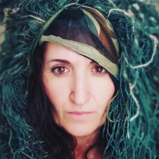
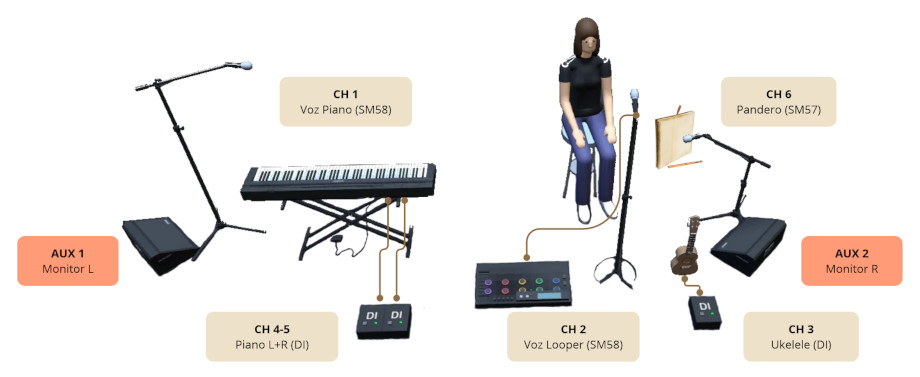





**Alma de Tüz** es un proyecto musical de canciones propias que entrelazan **raíz latinoamericana y folklore castellano con jazz y canción de autor**.

Para fans de Silvia Pérez Cruz, Silvana Estrada o Natalia Lafourcade.

En *Canto para mí*, Amanda está sola en el escenario con su voz, piano, ukelele, pandero cuadrado y looper. **Sin bases pregrabadas**: todo lo que suena se toca delante del público.

A tu sala llega **un directo cercano que emociona y empodera**, con espacio para la escucha, el silencio y la celebración.

Este es el dossier de la gira 2026-2027: repertorio, formato, rider técnico y calendario.

La producción y la contratación está a cargo de **Sala Oeste Producciones**.


{: .text-center }





## La artista
{: .fw-bold .text-center }

{: .img-left }

Amanda Tüz canta y compone. Estudió piano en el conservatorio, se licenció en Musicología y ha cantado música antigua, jazz, boleros y canción de autor. Con la Cotton Club Dixieland Jazz Band actuó en el Festival Internacional de Jazz de Getxo.

Es autora de **La Magara**, una canción que lleva casi diez años circulando de boca en boca por grupos de mujeres de todo el mundo. Entre 2017 y 2021 lideró el grupo **Magara**, y compuso parte de la banda sonora del documental *A Witch Story*, estrenado en DOC NYC.

Desde 2022 lidera **Alma de Tüz**, su proyecto más personal, con más de treinta canciones propias. «Tüz» significa aliento creativo y eso es lo que llega al público: canciones que **emocionan, empoderan y que invitan a la introspección**.





## Repertorio
{: .fw-bold .text-center }

*Canto para mí* es un cancionero de alta carga lírica y emocional sobre **los ciclos femeninos, el cuerpo, la memoria y la naturaleza creativa**.

Se mueve entre la canción de autor, el folk de raíz, la bossa introspectiva, las nanas y la improvisación vocal del jazz. La instrumentación cambia en cada canción enriqueciendo la desnudez que implica un concierto íntimo en solitario, permitiendo al público viajar por mutitud de sonoridades.

Pulsa en cada canción para escuchar un fragmento de los diferentes directos realizados hasta la fecha.







## Formato
{: .fw-bold .text-center }

Actuación en formato solista, voz y multi-instrumentisto.

Los instrumentos cambian en función de los temas interpretados, en las siguientes combinaciones:

|---|---|
| **Combinación 1** | Voz + Piano |
| **Combinación 2** | Voz + Ukelele |
| **Combinación 3** | Voz + Looper |
| **Combinación 4** | Voz + Pandero |
{: .table }

**Duración**: entre 60 y 90 minutos, de 12 a 16 canciones aprox.

**Público**: concierto íntimo de escucha, pensado para sala sentada y aforo pequeño o mediano.





## Rider técnico
{: .fw-bold .text-center }

{: .img-center }

### Instrumentos

| Instrumento | Descripción |
|---|---|
| **Piano** | Teclado Yamaha - Digital Piano P-125 |
| **Ukelele** | Ukelele tenor con pastilla electroacústica en el puente |
| **Pandero** | Pandero cuadrado de Peñaparda |
| **Looper** | Looper Boss RC-30 |
{: .table }

### Material de sonido

Sala Oeste Producciones monta el equipo técnico necesario para que la escucha sea adecuada a la sala y la cantidad de público.

En caso de que la sala disponga de equipo profesional equivalente, usaríamos el equipo instalado.

| Equipo | Descripción|
|---|---|
| **Mesa de mezclas** | Mesa digital - Soundcraft ui24R |
| **PA** | 2x Altavoces autoamplificados - JBL IRX-108 + Pie de altavoz Audibax |
| **Monitores** | 2x monitores de pie autoamplificados |
| **Micrófonos** | 2x Shure SM58 (voz) 1x Shure SM57 (pandero) |
| **Cajas de inyeccion** | 2x DI activa estéreo (piano) 1x DI activa mono (ukelele) 1x DI pasiva mono (looper) |
{: .table }

### Escenario

|---|---|
| **Escenario** | Unos 6 m² (3 m x 2 m aprox.). |
| **Corriente** | Un punto de corriente junto al escenario. |
| **Técnico** | Sala Oeste Producciones incluye un técnico de sonido que se coordina con el técnico de la sala. |
| **Montaje** | 1 h de montaje y 30 min de prueba de sonido antes de abrir puertas. Desmontaje 1 h. |
| **Luces** | En caso de no disponer de luces de escenario, Sala Oeste Producciones incluye dos focos led con pie |
{: .table }

### Lista de canales

| Canal | Fuente | Conexión |
|---|---|---|
| **CH 1** | Voz Piano | Shure SM58 |
| **CH 2** | Voz Looper | Shure SM58 > Boss RC-30 > Jack L/Mono > DI Pasiva |
| **CH 3** | Ukelele | Jack Mono > DI Activa |
| **CH 4-5** | Piano | Jack L > DI Activa Jack R > DI Activa |
| **CH 6** | Pandero | Shure SM57 |
{: .table }





## Fechas libres
{: #fechas .fw-bold .text-center }

Este es el calendario de la gira. Los días en verde siguen libres.







Si alguna fecha os encaja, escribir a:

**Sala Oeste Producciones**\\

{: .text-center }

Por favor, en el email especificar:
* **fecha** o fechas que las que están interesados
* **sala** y ciudad
* **ficha técnica** dela sala para poder evaluar el equipo técnico que Sala Oeste Producciones tiene que aportar

{% include engage_button.html
  name="escribir-sala-oeste"
  text="Escribir a Sala Oeste"
  url="mailto:booking@salaoeste.com?subject=Fechas%20de%20Alma%20de%20T%C3%BCz%20en%20nuestra%20sala"
%}
{: .text-center }


